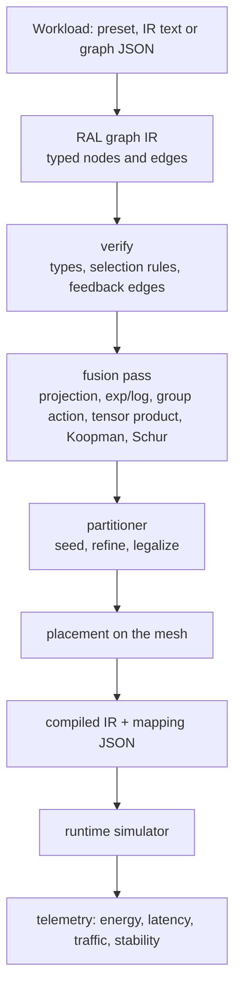
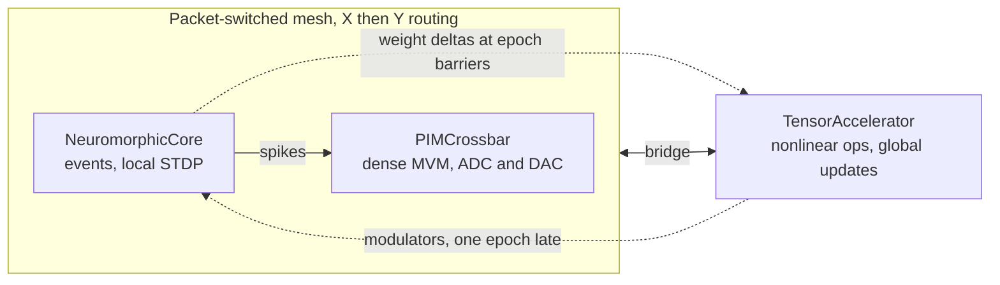

# NeuroGraph-HW

A compiler and runtime simulator that maps geometric neural circuits onto heterogeneous hardware.

You describe a circuit in a typed graph IR: group-equivariant operators, manifold projections, Koopman operators, continuous attractors, spiking populations and dense tensor ops. The compiler fuses what the geometry allows, then assigns each node to one of three targets with a cost model. A hybrid runtime simulates the result and compares it with a GPU-only baseline.

| Target | Models | Runs |
| --- | --- | --- |
| `NeuromorphicCore` | Asynchronous event-driven cores, Loihi 2 class | Sparse spiking dynamics, local STDP |
| `PIMCrossbar` | Analog in-memory crossbar tiles, PCM or ReRAM | Frozen dense matrix-vector products |
| `TensorAccelerator` | GPU or TPU class dense accelerator | Nonlinear tensor ops, high-precision reductions, global updates |

> **This is a simulator, not a hardware backend.** Functional behaviour is computed. Energy and latency are cost-model estimates from constants that mix published, derived and assumed values across different chips and process nodes. Treat every energy ratio as illustrative. See [Limits](#limits).

## Quick start

```bash
git clone https://github.com/selinozgursoy/neurocompiler
cd neurocompiler
docker compose up --build        # studio and API on http://localhost:7860
```

Without Docker:

```bash
pip install -e ".[dev]"
neurograph serve                 # http://localhost:7860
```

## Architecture





```
neurograph/
  ir/         types, nodes, graph, MLIR-style text printer and parser
  compiler/   hardware constants, cost model, fusion pass, partitioner, pipeline
  runtime/    mesh network, per-node kernels, hybrid engine
  geometry.py irreps, SO(3) representations, intertwiners, equivariance error
  workloads.py three preset circuits
  cli.py      neurograph compile | simulate | benchmark | presets | serve
api/          FastAPI service; also serves the studio
web/          studio: one HTML file, one script, one stylesheet, no build step
tests/        97 tests
docs/BLOG.md  the design, explained
```

## The IR

Five node classes in four dialects, with two edge kinds: `tensor` for continuous manifold data and `spikes` for sparse address-event packets.

| Node class | Ops | Output |
| --- | --- | --- |
| `ManifoldGroupAction` | `ral.geo.sph_harm`, `tensor_product`, `equiv_linear`, `fused_conv`, `group_act`, `project`, `exp_map`, `log_map` | `rep<G, "irreps">`, `point<M, d>`, `tangent<M, d>` |
| `KoopmanOperator` | `ral.dyn.koopman` | `tensor<n x i8>` |
| `ContinuousAttractor` | `ral.dyn.attractor` | `spikes<N, 8>` |
| `SpikeEventNode` | `ral.evt.encoder`, `lif`, `decoder`, `stim` | `spikes<N, b>` or `tensor<d x f32>` |
| `DenseTensorOp` | `ral.tensor.matmul`, `mlp`, `nonlinearity`, `reduce`, `readout` | `tensor<d x f32>` |

```mlir
// NeuroGraph IR v1
module @hippocampal_continuous_attractor_ring {
  %velocity = ral.evt.encoder {population = 64, fan_out = 256, rate = 0.08} : () -> spikes<64, 1> @NeuromorphicCore
  %ring = ral.dyn.attractor {plasticity = "local_stdp"} (%velocity) : (spikes) -> spikes<256, 8> @NeuromorphicCore
  %heading = ral.evt.decoder {population = 256} (%ring) : (spikes) -> tensor<2xf32> @TensorAccelerator
  %wrap = ral.geo.project {manifold = "torus", dim = 2, composed = 2} (%heading) : (tensor) -> point<torus, 2> @TensorAccelerator
  %path = ral.dyn.koopman {observables = 128} (%wrap) : (tensor) -> tensor<128xi8> @PIMCrossbar
  %place = ral.tensor.readout {plasticity = "global_sync", in_dim = 128, out_dim = 16} (%path) : (tensor) -> tensor<16xf32> @TensorAccelerator
}
```

Rules the verifier enforces:

- A value never changes world silently. Spikes reach a tensor op only through an explicit `ral.evt` codec.
- A tensor product whose output irreps violate the selection rules is invalid IR.
- A cycle must contain a `feedback` edge. Feedback edges are epoch-registered: readers see the previous epoch's writes.
- `local_stdp` is an ownership contract. The weight is written by an edge core, so the node must be an event-time op and is placed on a `NeuromorphicCore`.

## Compiler passes

**Fusion.** All rewrites are exact.

| Rewrite | Effect |
| --- | --- |
| `project . project` on one manifold | One projection |
| `exp_map . log_map` and the reverse | Both removed |
| `group_act . group_act` | One composed action |
| `tensor_product . equiv_linear` | One `fused_conv`, no materialized intermediate |
| `koopman . koopman` | One operator, K^k |
| `equiv_linear` | Schur-shared: one W_l per irrep type, read 2l+1 times |

**Partitioning.** Minimizes node energy plus cut-edge energy, with an optional latency weight. It seeds each node on its cheapest feasible target, refines one node at a time, legalizes shared capacity by evicting the node with the least regret, and falls back to the all-accelerator mapping if that is cheaper and no ownership contract forbids it.

| Target | Energy per step | Feasible when |
| --- | --- | --- |
| `NeuromorphicCore` | synaptic ops x 23.6 pJ + neuron updates x 52 pJ + STDP updates x 120 pJ | Event-time op, 8-bit weights, fits the cores |
| `PIMCrossbar` | ADC conversions + DAC drives + cell reads, calibrated to 0.403 pJ per MAC | Linear, 8-bit, not locally plastic, fits the tiles |
| `TensorAccelerator` | MACs x 2.56 pJ, plus DRAM traffic when weights exceed the cache | Always |
| Cut edge | flits x hops x 3.5 pJ, plus 40 pJ per byte across the bridge, plus transcoding | Always |

Every constant and its provenance is served at `GET /api/hardware` and defined in `neurograph/compiler/hardware.py`. Override any of them per request or with `--hardware file.json`.

## Runtime

Each 1 ms step is synchronous at the graph level and discrete-event inside the mesh. Nodes run in topological order between two barriers. Bursts on cut edges are routed X then Y and queue on shared links. Local plasticity runs on the cores every step. At each epoch barrier the fast weight deltas are shipped, projected back onto the circuit's symmetry, and committed; feedback edges swap at the same moment.

The heterogeneous run and the baseline receive identical stimuli, seeded by node id.

## Results from the simulator

400 steps, seed 0, default constants. Reproduce with `neurograph benchmark <preset>`.

| Preset | Energy per step, heterogeneous | GPU baseline | Energy | Latency per step | Weight bytes moved |
| --- | --- | --- | --- | --- | --- |
| SE(3) equivariant spatial circuit | 0.100 µJ | 0.124 µJ | 1.24x lower | 72 µs vs 80 µs | 51% fewer |
| Hippocampal attractor ring | 0.186 µJ | 0.599 µJ | 3.22x lower | 35 µs vs 60 µs | 95% fewer |
| Closed-loop BCI decoder | 1.961 µJ | 0.817 µJ | 2.40x **higher** | 108 µs vs 70 µs | 90% fewer |

What the numbers say:

- **Sparse dynamics pay.** The ring attractor is where heterogeneity wins, because a core pays per event. The break-even is about 10% activity for a 256-neuron all-to-all ring; above that the accelerator is cheaper.
- **On-core plasticity is expensive.** At 120 pJ per synaptic update, the BCI preset spends 82% of its energy on STDP and loses to an accelerator at peak efficiency.
- **Accuracy is not free.** Event coding costs the ring 0.10 rad RMS of phase error against 0.002 for the dense baseline. A Koopman operator on a crossbar with 1% device noise deviates 25% to 41% from its float trajectory even when re-encoded every 8 steps.
- **Shared cells keep symmetry.** With programming error alone, a Schur-shared equivariant map on a crossbar stays equivariant to machine precision. `tests/test_runtime.py::test_shared_cells_keep_symmetry_end_to_end` checks it.

## Limits

- **Dynamic energy only.** Static and idle power are not modeled on any target. For small real-time workloads they dominate real systems.
- **The baseline is generous.** The accelerator is charged its peak-efficiency energy per MAC, as if fully utilized.
- **Mixed provenance.** Loihi figures are from the 2018 chip, the crossbar figures from HERMES with ISAAC's ADC share, the accelerator from an A100 datasheet. Three constants are recalled, not re-verified; `GET /api/hardware` marks them.
- **Numeric simulation covers irreps up to l = 2.** Higher orders compile but do not simulate.
- **The memory wall is a step.** Weights are either cache-resident or streamed from DRAM; real behaviour is smoother.
- **Latency model is coarse.** Cores and tiles run in parallel, accelerator kernels in sequence, each paying a fixed launch cost.

## CLI

```bash
neurograph presets
neurograph compile hippocampal_ring -o ring.mlir --mapping ring.mapping.json
neurograph compile examples/bci_decoder.mlir --report
neurograph simulate se3_spatial --steps 400
neurograph benchmark bci_decoder --steps 400 -o telemetry.json
neurograph compile se3_spatial --hardware my_board.json
```

## API

| Method | Path | Does |
| --- | --- | --- |
| GET | `/api/health` | Liveness |
| GET | `/api/presets` | Preset workloads with IR and graph JSON |
| GET | `/api/hardware` | Default constants and their provenance |
| POST | `/api/ir/parse` | Validate IR text, return graph JSON |
| POST | `/api/compile` | Compiled IR, mapping, report, layout |
| POST | `/api/simulate` | Telemetry for one mode |
| POST | `/api/benchmark` | Heterogeneous against GPU-only, with comparison |

A request gives exactly one of `preset`, `ir_text` or `graph`. Interactive docs are at `/docs`.

```bash
curl -s localhost:7860/api/benchmark -H 'content-type: application/json' \
  -d '{"preset": "hippocampal_ring", "steps": 200, "hardware": {"pim": {"read_noise": 0.005}}}'
```

## Studio

Pick a preset or edit the IR or graph JSON. The studio draws the compiled graph with nodes colored by target and labelled with their plasticity mode, charts energy, latency, interconnect traffic and stability against the baseline, and exports the compiled IR and mapping JSON. "Copy share link" puts the whole state in the URL.

## Deploy

The container listens on `$PORT`, default 7860.

| Host | Steps |
| --- | --- |
| Hugging Face Spaces | Create a Docker Space and push this repo. The front matter at the top of this file configures it. |
| Render | New Blueprint from this repo; `render.yaml` is included. |
| Railway | New project from this repo. It builds the Dockerfile and sets `PORT`. |
| Fly.io | `fly launch --internal-port 7860`, then `fly deploy`. |
| Any Docker host | `docker run -p 7860:7860 $(docker build -q .)` |

## Tests

```bash
pip install -e ".[dev]"
pytest
```

97 tests cover IR construction and validation, text and JSON round trips, the geometry helpers, each fusion rewrite, cost-model feasibility, partitioner routing invariants and capacity legalization, the mesh network, runtime accounting and determinism, the API and the CLI.

## License

MIT. See `LICENSE`.
